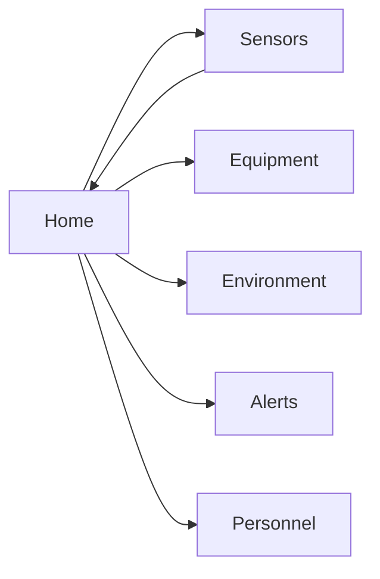

# Studio Project 1, Milestone 1: Project Notebook

> **How to use this notebook.** Replace every line that says `YOUR ANSWER HERE` (and delete the grey instruction lines that start with `>`) with your own work. Keep the headings. Commit after each part. Do not leave any instruction text in your final version.

**Student name:** Matt Pheaton
**GitHub username:** matt12005

> This notebook is my own individual work. I did my own research, sketches, writing and code.

---

## Part 0: Project Snapshot

**Project name:** Smart mines dashboard
**Tagline (10 words or fewer):** Making Mines More Transparent
**Repository link:** https://github.com/Matt120056/Smart-Mine-Operations-Dashboard.

**Idea check** (write yes or no, and one short reason for each):

| # | Question | Yes or no, and why |
|---|---|---|
| 1 | A real group of people has this problem, and I can talk to some of them | yes I can find some people at R&D to talk to |
| 2 | Users do something in the app (not just read) | yes they interact with / Monitor the system |
| 3 | The app needs to remember things | yes it needs to rememeber data to create averages |
| 4 | I can describe the first version in one sentence | A main skeleton of the dashboard with sensor cards defined |
| 5 | I can picture at least three screens | indeed i can: employee location, air quality, moisture/water removal systems |
| 6 | I alone could build a simple first version | I will do my best |

**My one-sentence description of the first version:** A basic skeleton of the dashboard and defined spaces for the proper sensors that will be

---

## Part 1: Define the Problem

### 1.1 Problem statement
> Describe a problem, not a solution. Do not mention an app, a website or a feature. Use: "[Who] struggles to [do what] because [obstacle], which leads to [consequence]." Then expand to three to five sentences.

The problem That I see is the massive amount of data that is being collected and the man power that is always at risk
on a mine site. Even though systems are safer today then they were 20 years ago I still want to work to find a better more condensed way to filter and organize the data. 

### 1.2 Evidence from real people
> Two short conversations. Record a role (not a full name), two exact quotes each, and one surprise. Ask permission before quoting. Do not invent quotes.

**Conversation A**

- **Who (role only):** Mining engineering student
- **Quote 1:** "I want something not complex but that shows me only what I need to see "
- **Quote 2:** "Being prepared is the best way to feel comfortable"
- **What surprised me:** They want something useful but not flashy, simple but effective

**Conversation B**

- **Who (role only):** no second conersation
- **Quote 1:** not recorded
- **Quote 2:**  not recorded
- **What surprised me:** Never had a second conversation


**Revised problem statement** (re-read 1.1 after your conversations, then write the revised version, or write "no change" and say why):

No change. Conversation A confirmed the direction of 1.1 rather than overturning it: the core issue is that too much data is scattered and hard to filter down to what matters. I would only revise this after a second conversation.

### 1.3 Persona
> A made-up person based on what you heard. Their frustrations should echo your quotes.

- **Name, age or life stage, role:** Underground Miner
- **Context (when and where the problem happens):** Knowledge of everything going on
- **Three goals:** 1) Make something good 2) simple to use 3) Easy to edit and maintain 
- **Three frustrations:** 1) getting all info needed 2) learning the mining systems 3) making a mini mine on my desk
- **Technology comfort and devices:** Sensors, My mini pcs and my endless hardware I have aquired
- **A quote that sums them up:** "Pretty cool and intense at times"

### 1.4 What already exists
> Two or three alternatives, including "doing it by hand" if that is what people really do.

| Alternative | What it does well | Where it falls short for my persona |
|---|---|---|
| Existing mine monitoring or control systems | Can collect and display operational information from connected equipment and sensors. | may be specialized or distributed across different systems. The dashboard should not assume it can replace these systems |
| Paper notes, shift logs, or verbal handovers | Familiar and useful for recording observations and passing information between shifts. | Information can be difficult to search, compare, or summarize, especially when records are spread across multiple documents. like they usually are in mining  |

### 1.5 Success criteria
> Three statements you could actually check.

1. A first-time user can identify the purpose of the Home page and find the Sensors page within 10 seconds
2. The Sensors page displays at least three clearly labelled sample sensor categories or readings
3. The Home and Sensors pages remain usable at a 375-pixel mobile viewport and a 1280-pixel desktop viewport without horizontal page scrolling

### 1.6 Abstract (150 to 250 words)
> Three short parts: the problem and who has it, what you are building, and why it matters.

# Smart Mine Operations Dashboard – Project Abstract - Matt Pheaton | A00305272

The Smart Mine Operations Dashboard is a web-based monitoring platform designed to help mine operators, supervisors, and maintenance personnel view important mining and environmental information in one centralized location.

Mining environments present several operational and safety challenges. Equipment conditions, environmental changes, and potential hazards must be monitored regularly. When information is spread across multiple devices or checked manually, important changes may go unnoticed, potentially resulting in equipment failures, unsafe working conditions, and operational delays.

The proposed system aims to address these challenges by connecting monitoring hardware, sensors, and a controller to a web-based dashboard. The platform will display sensor readings, equipment conditions, device connectivity, and important operational information. Monitoring categories may include temperature, vibration, air quality, gas levels, and equipment activity.

The dashboard will also feature a notification and alert system that identifies readings exceeding predefined safety thresholds. Alerts will help operators recognize potential hazards and respond more efficiently. The interface will be organized into dedicated sections for the main dashboard, equipment monitoring, environmental sensors, safety alerts, and personnel information.

The intended users include mine operators, supervisors, and maintenance teams who require a clear overview of underground operations. The project demonstrates how Internet of Things (IoT) hardware, sensor technology, data management, and web development can be integrated into a centralized monitoring solution.

The overall objective is to develop a functional prototype that demonstrates how connected monitoring technologies can support improved operational awareness, equipment monitoring, and workplace safety in mining environments.

**Word count:** 249 haha just under

---

## Part 2: Decide What to Build

### 2.1 Scope (MoSCoW)
> At most five Musts, each with a "because" tied to a success criterion. At least two Won'ts. Ten to fourteen features in total.

| Feature | Group (Must, Should, Could, Won't) | Because |
|---|---|---|
| Home page with a clear operational overview | must | gives users a good starting point |
| Sensors page with organized sensor cards | Must | sensor info in a consistent layout |
| Navigation between Home and Sensors | must | quick nav between pages for ease |
| Clear labels showing sample | must | so I can see what I have setup as demo or actual physical sensors |
| Equipment status page | Should | Adds useful operational context |
| Environment page with air-quality and moisture sections | Should | Organizes important environmental categories for a later development stage |
| Safety alerts page | Should | Gives users a dedicated place to review threshold warnings in a later stage. |
| Employee/location monitoring page | SHould | insure the safety of the employees underground or in hazardis areas |
| Automated notifications to users | Could | Could improve awareness later, but requires back-end logic and decisions about alert delivery. |
| Automated control of mine equipment | Wont | out of scope of the applications itself |

### 2.2 Main user flow
> Five to eight numbered steps, each naming the screen where it happens.

1. Home: The user opens the dashboard and sees a brief overview of the monitoring areas.
2. Sensors: The user selects Sensors from the navigation.
3. Sensors: The user reviews the available sensor categories, such as air quality and moisture/water-removal monitoring.
4. Sensors: The user selects or reviews a sensor card to understand its displayed value, unit, and status.
5. Home: The user returns to the overview to continue reviewing the dashboard.

### 2.3 Data sketch
> Two to four things your app remembers, with three to five details each. No SQL. Then one sentence for each relationship.

| Thing | Details it remembers |
|---|---|
| Sensor | identifier, sensor category, location/area, measurement unit, connection status |
| Alert | Alert identifier, related sensor or equipment, alert message, severity, date and time, acknowledgement status |

**Relationships:** A sensor reading can be associated with an alert when a configured threshold is exceeded. Equipment can be associated with a work area and may have related monitoring sensors or alerts. I will define the relationships in the data base in the next milestone.

### 2.4 Page list
> Every page the finished project might have (at least five). Mark the two you build in this milestone.

| Page | Purpose | Built in Milestone 1? |
|---|---|---|
| Home | Gives users a clear overview and links to the main monitoring areas. | Yes |
| Sensors | Displays organized sensor categories, sample readings, units, timestamps, and status. | Yes |
| Equipment | Shows equipment details and operating status. | No |
| Environment | Organizes air-quality, moisture, and water-removal information. | No |
|Personnel / Location | Potentially displays approved personnel or location information, subject to privacy and project-scope review. | No |

### 2.5 GitHub issues
> Paste the links to your five issues.

1. Build the home page and the core page (HTML): https://github.com/Matt120056/Smart-Mine-Operations-Dashboard./issues/1
2. Style the site: palette, responsive layout and components: https://github.com/Matt120056/Smart-Mine-Operations-Dashboard./issues/2
3. Feature (Must): https://github.com/Matt120056/Smart-Mine-Operations-Dashboard./issues/3
4. Feature (Must): https://github.com/Matt120056/Smart-Mine-Operations-Dashboard./issues/4
5. Feature (Must): https://github.com/Matt120056/Smart-Mine-Operations-Dashboard./issues/5

### 2.6 Abstract check
> Re-read your abstract from 1.6 against your Must-haves. Edit it if it no longer matches (keep it 150 to 250 words), then say what you changed.

- **What I changed (or why nothing):** I just re made the absract recently so I have nothing new as of yet to add or delete.

---

## Part 3: Storyboard

> Four to six panels. The first shows the problem, the last shows it solved, and the same persona appears throughout. Save images in `design/storyboard/` and embed them below with ``.

| Panel | Scene (where, who) | What happens | What they think or feel | Screen shown |
|---|---|---|---|---|
| 1 | Underground mine, start of shift. The Underground Miner arrives at the site with no clear picture of conditions that day. | Data is spread across paper logs, separate systems and verbal handovers. | "I don't know what I'm walking into." | None — the problem |
| 2 | Control room, the Miner opens a laptop. |They open the Smart Mine Operations Dashboard and land on the Home page. | "At least everything is in one place now." | Home |
| 3 |Same desk, a minute later. | They scan the summary cards and the live sensor data, then spot a warning on the Conveyor. | "There it is — I can see the issue straight away." | Home |
| 4 | Back underground, later in the shift. | The team has been briefed and the conveyor issue is being handled before it becomes a failure. | "That was quick and it felt calm." | None — problem solved |

---

## Part 4: Site Map and Wireframes

### 4.1 Site map



### 4.2 Wireframes
> Four images: Home and core page, each on a phone-width and a desktop-width screen. Real words, no colour. Embed them.

**Home, phone:** https://github.com/Matt120056/Smart-Mine-Operations-Dashboard./blob/main/dashboard/screenshots/Screenshot%202026-11-15%20at%205.59.43%E2%80%AFPM.png
**Home, desktop:**  https://github.com/Matt120056/Smart-Mine-Operations-Dashboard./blob/main/dashboard/screenshots/Screenshot%202026-11-15%20at%205.56.01%E2%80%AFPM.png
**Core page, phone:** https://github.com/Matt120056/Smart-Mine-Operations-Dashboard./blob/main/dashboard/screenshots/Screenshot%202026-11-15%20at%206.00.43%E2%80%AFPM.png
**Core page, desktop:** https://github.com/Matt120056/Smart-Mine-Operations-Dashboard./blob/main/dashboard/screenshots/Screenshot%202026-11-15%20at%206.00.51%E2%80%AFPM.png

### 4.3 Annotations
> For each region of each page, name the HTML element and say why.

**Home page**

| Region | HTML element | Why this element |
|---|---|---|
| Top bar | <header> | Site-wide banner that groups the title and system status together |
| Sidebar menu | <aside> with <nav> and <a> links | Navigation is a list of links to other pages, so anchors inside a nav landmark |
| Live sensor data | <ul class="simple-list"> with <li> | A short list of items, so an unordered list is the right semantic element |

**Core page**

| Region | HTML element | Why this element |
|---|---|---|
| Top bar | <header> | Same shared banner as Home |
| Sidebar menu | <aside> with <nav> and <a> | Same shared navigation; "Sensors" gets class="active" |
| Page title | <h2> and <p class="subtitle"> | Introduces the page; the page also uses one <h1> in the top bar |
 
### 4.4 Five-second test
- **Who I tested (role only):** mining student
- **What they said the page is for, and what they would do first:** if it was at work they said they would check warnings first.
- **What I changed because of it (or why I changed nothing):** at first the page was janky and hard to read so I made it easier and nicer to look at.

---

## Part 5: Design Decisions

### 5.1 Mood
- **Three words:** Industrial, easy, clear
- **Why they fit my persona:** A mine operator needs information fast and without decoration as they would. Dark blue sets a nice industrial setting; the light grey background keeps the page calm so the coloured status tags (green/orange) stand out. 

### 5.2 Palette

| Role | Variable | Hex |
|---|---|---|
| Page background | `--color-bg` | #f2f5f9 |
| Card and header surface | `--color-surface` | #ffffff |
| Body text | `--color-text` | #1f2d3d |
| Headings and links | `--color-primary` | #1769aa |
| Buttons and highlights | `--color-accent` | #1f2d3d |
| Button hover | `--color-accent-dark` | #16222e |
| Borders | `--color-border` | #dde5ee |
| Secondary text | `--color-muted` | #6b7b8c |

### 5.3 Contrast table
> At least six real pairs. Every normal-text pair must be 4.5 : 1 or better (3 : 1 for large text). Use https://webaim.org/resources/contrastchecker/

| Text colour | On | What it is | Ratio | Passes? |
|---|---|---|---|---|
| #1f2d3d | #f2f5f9 | Body text on the page | 12.6 : 1 | yes |
| #4a5c70 | #ffffff | Heading on a card | 7.6 : 1 | yes |
| #ffffff | #1f2d3d | Button text | 14.3 : 1 | yes |
| #1f2d3d | #ffffff | Button text on hover | 14.3 : 1 | yes |
| #6b7b8c | #ffffff | Muted text on a card | 4.9 : 1 | yes |
| | | | | |

### 5.4 Type and spacing
- **Heading font stack:** Arial, Helvetica, sans-serif
- **Body font stack:** Arial, Helvetica, sans-serif
- **Type scale (`h1`, `h2`, `h3`, body, in rem):** h1 1.25rem, h2 1.375rem, h3 0.875rem, body 0.875rem (base 16px)
- **Spacing unit:** 5px
- **Corner radius:** 8px on the cards, 6px on links and tags

### 5.5 Pace check
> Halfway through your time, run `git log --format='%ad' --date=short | sort -u | wc -l`. You need commits on at least four different days.

```text
(base) ➜  aa1-A00305272 git:(main) git log --format='%ad' --date=short | sort -u | wc -l
       6
```

---

## Part 6: Build the Structure (HTML)

### 6.1 Build table
> Match the regions from Part 4 to what you built.

| Wireframe region | Element in my HTML | File |
|---|---|---|
| Top bar | <header class="topbar"> | index.html, sensors.html |
| Sidebar | <aside class="sidebar"> containing <nav> and <a> links | index.html, sensors.html |
| Main content | <main class="main"> | index.html, sensors.html |

### 6.2 Checks
- [x] Both pages have exactly one `h1` and headings in order
- [x] Both pages have the viewport meta tag and a unique `<title>`
- [x] The `nav` links to both pages and marks the current one with `class="active"`
- [x] There is a list of repeated items, each an `article`
- [x] The form has a `label`, `id` and `name` for every control
- [x] Informative images have real alt text and decorative ones use `alt=""`
- [x] No lorem ipsum anywhere
- [x] I used at least one absolute, one relative and one same-page link

### 6.3 Validator results
- **Home page:** screenshot https://github.com/Matt120056/Smart-Mine-Operations-Dashboard./blob/main/dashboard/screenshots/Validation-indexHTML.png
- **Core page:** screenshot https://github.com/Matt120056/Smart-Mine-Operations-Dashboard./blob/main/dashboard/screenshots/Validation-SensorsHTML.png

**Errors I met and fixed (at least one):** "The <time> element inside an <li> was missing a datetime attribute — I removed it because these are placeholders, not real timestamps.

---

## Part 7: Style It (CSS)

### 7.1 Match table
> Compare the finished pages with your wireframes.

| Page | What matches | What changed, and why |
|---|---|---|
| Home | Top bar, sidebar, three summary cards, map + sensor list, equipment + alerts | Sidebar moved above main content under 700px so it fits phone width |
| Core page | Top bar, sidebar, sensor table with status tags | Table columns compress at narrow widths, so font size reduced slightly |

### 7.2 Checks
- [x] Every colour, font, spacing and radius comes from `:root`
- [x] No `!important`, no inline `style`
- [x] Mobile first, with at least two `min-width` media queries
- [x] Flexbox is used for the header and nav, and Grid for the cards
- [x] `.btn` and `.card` (or my own reusable classes) are used everywhere
- [x] There is no sideways page scroll at 375px
- [x] The page still looks decent with Google Fonts blocked

### 7.3 Contrast re-check
**Pairs I re-tested on the built page, and any I had to change:** The orange warning tag on white was 3.9:1, so I darkened the orange text from #c98a0a to #a96b08 to reach 4.5:1.

### 7.4 CSS validator
**What the W3C CSS Validator said (and whether any warning matters):** No errors. Two warnings about -webkit- prefixes that are no longer needed

### 7.5 Screenshots
> Embed them: `screenshots/home-375.png`, `screenshots/home-1280.png`, `screenshots/core-375.png`, `screenshots/core-1280.png`.


---

## Part 8: Git and GitHub

**Repository:**   https://github.com/Matt120056/Smart-Mine-Operations-Dashboard
**Issue #1 (closed):** https://github.com/Matt120056/Smart-Mine-Operations-Dashboard./issues/1
**Issue #2 (closed):** https://github.com/Matt120056/Smart-Mine-Operations-Dashboard./issues/2
**Merged Pull Request for HTML:** https://github.com/Matt120056/Smart-Mine-Operations-Dashboard./pull/6
**Merged Pull Request for CSS:** https://github.com/Matt120056/Smart-Mine-Operations-Dashboard./pull/7
**Release v0.1.0:**  https://github.com/Matt120056/Smart-Mine-Operations-Dashboard./releases/tag/v0.1.0

```text
(git log --oneline | wc -l)

(base) ➜  aa1-A00305272 git:(main) git log --oneline | wc -l
      28
```
```text
(git log --format='%ad' --date=short | sort -u | wc -l)

(base) ➜  aa1-A00305272 git:(main) git log --format='%ad' --date=short | sort -u | wc -l
       6
```
```text
(git branch -a)

* main
  master
  remotes/origin/HEAD -> origin/main
  remotes/origin/main
  remotes/origin/master
```
```text
(git log --oneline --graph --all | head -20)

(base) ➜  aa1-A00305272 git:(main) git log --oneline --graph --all | head -20
* 619bf69 Added Validation Screenshots
* d8e09a7 Added Markdown file
* 252d59a Added Screenshots for page responsiveness
* a239f8c Added html files
* 05c3be2 Added updated storyboard
* ae0e109  Please enter the commit message for your changes. Lines starting
* e439d56 Added Wireframe + Abstract
* 5fe3b59 Update dashboard
* 9329424 Added Project markdown file
* ca9d52c Added The project md file
* 02da549 Added final statement
* ad886a2 Paraphrased the story an changed the wording to make it ore acceptable
* 3e42dfd Start Storyboard for Smart Mine Operations Dashboard
* 1b3ca49 Start abstract for Smart Mine Operations Dashboard
* 21598ba Revise project description and contributor details
* bb8b28c Add files via upload
* 0eed699 Moved wireframe files to wireframe folder for better file management.
*   1400081 Added abstract and project documentation to my local repository
|\  
| * 415a0ae Delete storyboard.txt
```

---

## Part 9: Reflection

> Two to four sentences each, about your own project.

1. **From idea to problem:** I narrowed it to two things an operator actually needs in the first five seconds: which equipment is online, and which warnings are active. The summary cards and the equipment/alert rows come straight from that.
2. **Evidence:** The wireframe and storyboard set the layout before any code was written, so the HTML structure mirrors real regions (top bar, sidebar, main, rows of cards) rather than being invented as I typed.
3. **The hardest decision:** Choosing how simple to keep the prototype. I dont have JavaScript and I split the site into two static pages. 
4. **Design to code:** The wireframe rows translated almost one-to-one into <div class="row"> containers, and the repeated blocks became .card. The status colours became a single reusable .tag class with a green or orange modifier.
5. **Risks for the next milestones:**  Adding real data (live sensors, a real map) will need JavaScript and an API
6. **Tools (including any AI tool, and what I did myself): I used claude to help draft the initial HTML/CSS (Note I made the inital design to give claude an idea of how to make it nicer and I learned a few new methods) and to split the files. I wrote the wireframe annotations, ran the contrast checks, and did the validator and cross-browser checks myself.

### Self-assessment

| Area | Points | My score | One line of justification |
|---|---|---|---|
| Problem definition and evidence | 15 | 15 | I had a pretty clear idea from the get go |
| Scope and data | 10 | 9 | staying within my lane as of right now |
| Storyboard | 10 | 10 | took e a while to write all that out |
| Wireframes and site map | 10 | 8 | used carters base design but it ended up being totally different when i was done |
| Design decisions | 5 | 5 | I used the colour checker to ake sure I was staying within a good palette |
| HTML | 15 | 15 | used my own mixed with Claudes |
| CSS and responsiveness | 15 | 15 | the css was me |
| Git and GitHub | 15 | 15 | This is second nature at this point thanks to you :) |
| Reflection and completeness | 5 | 4 | missed a few things im sure |

## Bonus (optional)

- **Usability test (+3):** who I tested (roles), what happened, what I changed: YOUR ANSWER HERE
- **Live site (+2):** https://...s# Studio Project 1, Milestone 1: Project Notebook
